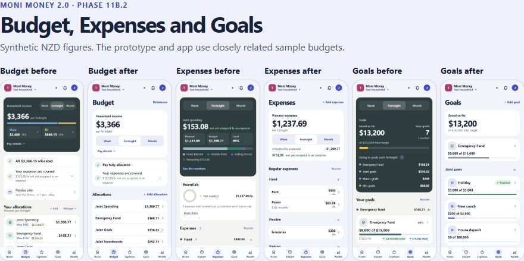

# Moni Money 2.0 · Phase 11B.2 Review

## Scope and baseline

The branch starts from the deployed Phase 11B.1 merge a1e729e. Budget, Expenses and Goals now use the approved Indigo surfaces, typography, list rows, disclosures and editing styles. The five-tab shell remains the Phase 11B.1 shell.

## Screen changes

| Screen | First view | Supporting controls |
| --- | --- | --- |
| Budget | Period income, allocation status, expense coverage and the allocation list. The Budget header has a direct Rebalance action. | Pay details shows individual pay and opens each person's editor. Allocations show amounts and relevant ownership. The editor keeps contributions, ownership and destinations. Reorder and Payday Playbook remain reachable below the allocation list. Fair split and breakdowns expand on demand. |
| Expenses | Planned amount for the period, money allocated to expenses, plus a remaining amount or warning. The recurring list leads with names and billing cadence. | Groups retain Fixed, Flexible and Sinking. Category totals and essentials are under Expense breakdown. A name-only expense reads as needing an amount. True zero displays as an amount. Add expense is in the header, with suggestions available from the list or empty state. |
| Goals | Saved money and compact cards with saved versus target. A first-goal state provides one primary Add a goal action. | Funding overview contains the period control and pool recap. Goal editors contain the funding shares and timing. Invalid goal shares still appear on the main screen. Account earmarking, contributions, deadline, rollover, combination and reordering use the existing workflows. |

Allocation, income, expense and goal editors use the new surfaces. Advanced allocation settings and goal funding remain expanded during in-place redraws. Ordinary edits keep the existing save-on-edit behaviour. Rebalance uses the existing preview, conflict handling and Undo. User-picked accents and record colours stay independent.

## Financial checks

The financial calculation modules, saved baseline JSON, Phase 12A store, Supabase schema and migrations are outside the changes. The five numerical fixture suites were run against the deployed baseline and the new view code. Budget, Expenses, Goals, Net worth and Investments matched their saved results, including week, fortnight and month views.

Browser coverage includes separate allocation and expense health, classified and sinking expenses, overfunded goals and funding rollover, edit/Undo and existing permissions and offline draft tests. The new finance checks cover the layout at 320, 375, 390, 430, 768 and 1280 px with enlarged text, long user-entered names and large amounts. The full automated suite runs in GitHub Actions. See the draft PR's latest Checks for the complete results.

## Visual review and known limits

The review package includes 390 px PNGs in Light and Dark for solo and shared Budget, over-allocation, under-allocation, shortfall, Expenses, breakdown, multiple and solo Goals, empty Goals, and allocation, expense and goal sheets. Figures are synthetic NZD. The prototype and implementation use closely related sample data. Production retains custom record colours and the existing category and household controls.

Physical iPhone hardware safe areas, Safari, the installed web app and VoiceOver require manual review. Browser automation covers responsive layout, keyboard activation and focus, dialogue width and the reduced-motion preference.

## Manual iPhone checklist

1. Open a private review copy in Safari and add it to the Home Screen using synthetic solo and shared households. Check Light, Dark and a saved custom accent at regular and larger text sizes.
2. On Budget, change periods, verify separate coverage and allocation messages, open Pay details, and edit a contribution. Verify Rebalance preview and Undo in the synthetic budget.
3. On Expenses, check the planned, allocated and shortfall labels. Edit a name-only suggestion, an explicit zero, and a yearly sinking expense. Verify the keyboard, due month and saved amount.
4. On Goals, add a first goal, expand its funding, edit a deadline and reorder two goals. Verify that a completed goal's contribution rolls to the next eligible goal and that an earmark leaves account balances alone.
5. With VoiceOver, check the selected period, focus return, the row amounts, and sheet titles. Close a sheet and switch households. Reconnect after an offline edit and verify that feedback still refers to the correct household.

## Next scope after approval

11B.3 covers Wealth Accounts, Investments and History, onboarding, Settings and app-wide consistency. Keep required payday dates, optional expense suggestions and Show me around. If a release needs rollback, restore the verified 11B.1 frontend with a fresh service-worker fingerprint and retain the Phase 12A isolation code and existing scoped drafts.
